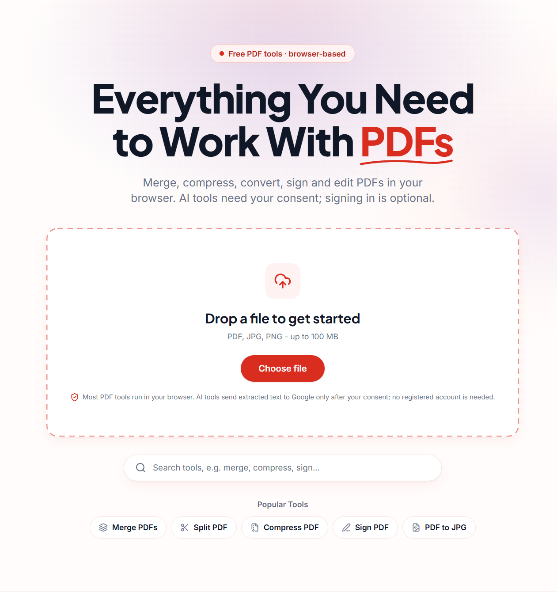
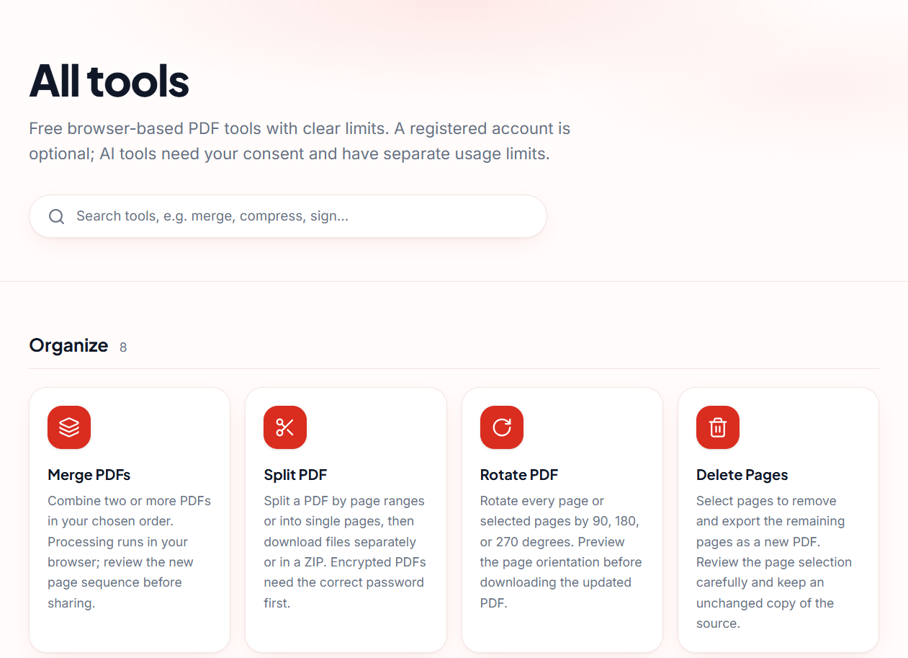
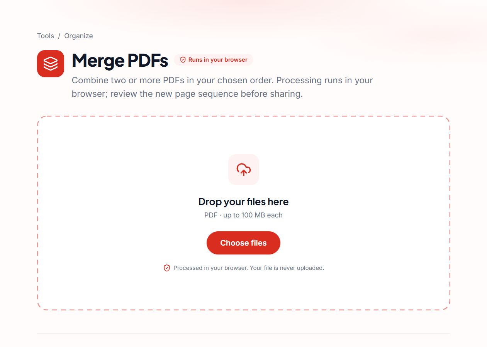
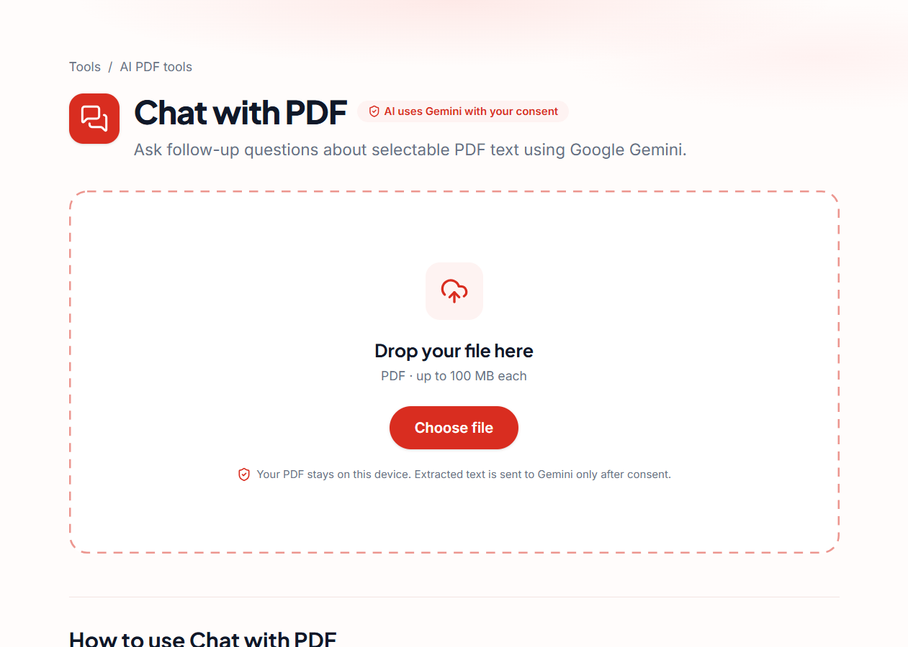
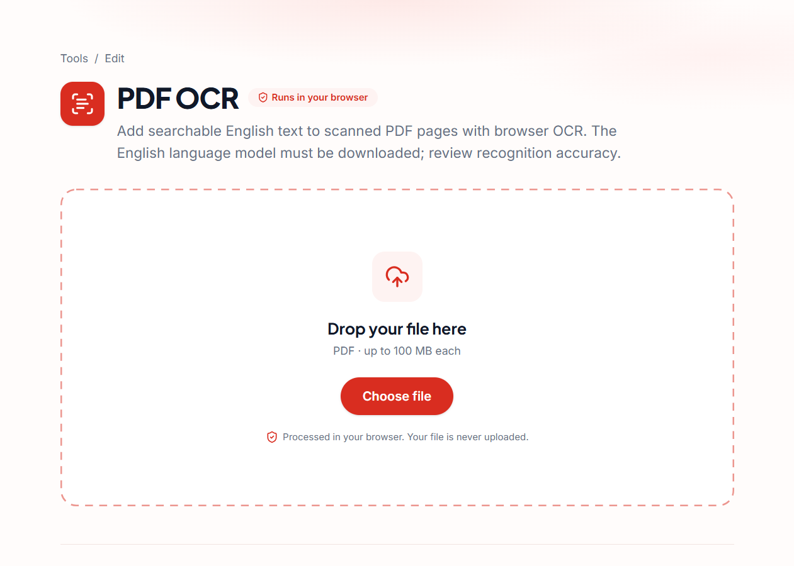
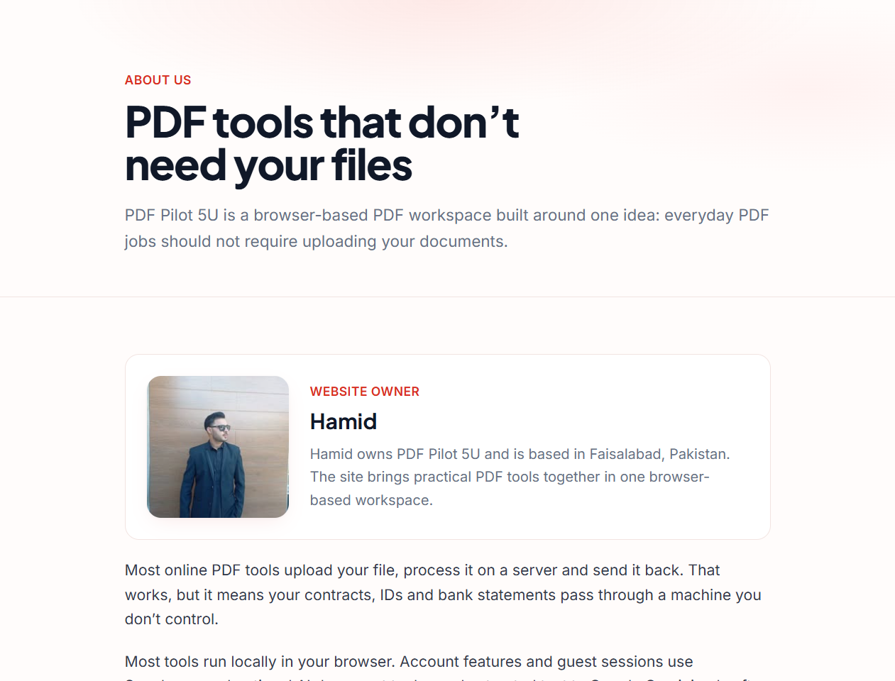

# PDF Pilot 5U

<p align="center">
  
</p>

<p align="center">
  Browser-first PDF tools for everyday document tasks. Pick a tool, process locally where supported, and download your result.
</p>

<p align="center">
  <sub>Built with TanStack Start, React, TypeScript, PDF.js, and pdf-lib.</sub>
</p>

<p align="center">
  <a href="https://pdfpilot5u.vercel.app/"><strong>Open PDF Pilot 5U ↗</strong></a>
  ·
  <a href="#product-screenshots">Explore the screenshots</a>
</p>

## Product screenshots

These screenshots show the live interface with no user documents selected.

<table>
  <tr>
    <td align="center" width="50%">
      <a href="./screenshots/homepage.png"></a><br />
      <strong>Start from the homepage</strong><br />
      <sub>Choose a file or search for a PDF task; the 100 MB per-file limit is shown up front.</sub>
    </td>
    <td align="center" width="50%">
      <a href="./screenshots/tools-library.png"></a><br />
      <strong>Find the right tool</strong><br />
      <sub>Browse the categorized library or search by task, such as merge, split, or rotate.</sub>
    </td>
  </tr>
  <tr>
    <td align="center" width="50%">
      <a href="./screenshots/merge-pdf.png"></a><br />
      <strong>Merge PDFs in your browser</strong><br />
      <sub>Select PDFs, review their order, and check the result before downloading.</sub>
    </td>
    <td align="center" width="50%">
      <a href="./screenshots/ai-chat.png"></a><br />
      <strong>Use optional AI with consent</strong><br />
      <sub>The page explains that extracted text is sent to Gemini only after permission.</sub>
    </td>
  </tr>
  <tr>
    <td align="center" width="50%">
      <a href="./screenshots/pdf-ocr.png"></a><br />
      <strong>Make scanned PDFs searchable</strong><br />
      <sub>English OCR runs in the browser; the model download and accuracy review are disclosed.</sub>
    </td>
    <td align="center" width="50%">
      <a href="./screenshots/about.png"></a><br />
      <strong>Learn about the project</strong><br />
      <sub>Meet Hamid, the site owner, and read about the browser-first approach.</sub>
    </td>
  </tr>
</table>

## Try it in three steps

1. Open [PDF Pilot 5U](https://pdfpilot5u.vercel.app/).
2. Search for a tool or choose one from the library, then select your file.
3. Review the result and download it. For AI tools, approve the consent prompt before extracted text is sent to Google Gemini.

## Chrome extension

PDF Pilot 5U also includes a lightweight Manifest V3 Chrome extension in [`extension/`](./extension). It provides quick access to the live tools—All Tools, Merge, Split, Compress, and OCR—plus a right-click shortcut. PDF processing remains on the website; the extension does not copy or upload documents.

### Install the extension locally

1. Download the latest `pdf-pilot-5u-chrome-extension.zip` from [GitHub Releases](https://github.com/hyxeekhan-lang/PDF-Tools-5U/releases).
2. Extract the ZIP file.
3. Open `chrome://extensions` and enable **Developer mode**.
4. Click **Load unpacked** and select the extracted `extension` folder.

The Chrome Web Store publication is separate and requires a Chrome Web Store developer account and review.

## What to expect

- Most PDF tools process source files in your browser. Optional AI sends extracted text to Google Gemini only after your explicit consent; a registered account is not required.
- Local files are limited to 100 MiB each. Browser memory and device resources can impose additional practical limits.
- Basic DOCX, XLSX, PPTX, and HTML conversions extract text into a simple PDF; they do not preserve layout or embedded media. PDF-to-DOCX/XLSX exports selectable text with simplified structure, and PDF-to-PowerPoint converts each page into a full-slide image.
- English OCR downloads its language model from Tesseract's configured CDN. Redaction rasterizes every page and removes interactive content; inspect each page and result before sharing.
- Protect PDF applies AES-256 encryption locally. Unlock PDF requires the correct password; password recovery and bypass are not provided.

## External integrations

Authentication and user-scoped history use Neon Auth and Neon’s Data API. Copy `.env.example` to `.env.local` and set
`VITE_NEON_AUTH_URL` from the Neon integration; set `VITE_NEON_URL` only if the Data API base URL cannot be derived
from the Auth URL. In Neon Console, select the production branch connected to Vercel, open **Postgres database >
Data API**, select **Use Neon Auth** in Settings, and enable the Data API. Data API is branch-specific; the Vercel
integration alone does not enable it. Leave broad public-schema grants off; the migration grants only the required
tables. Vercel Production runs `npm run migrate:neon` before building;
the script checks the required Neon Auth role/function and applies `neon/schema.sql` once using the server-only
`DATABASE_URL_UNPOOLED` (or `DATABASE_URL`). Apply the schema manually in the SQL editor only for a separate local or
development database. Configure the production domain as a trusted origin and set up Google OAuth/email delivery in
Neon Auth before offering those flows.
Optional Firebase Analytics uses the public `VITE_FIREBASE_*` web configuration
and is initialized only when valid configuration is present and the user chooses “Accept all” in the cookie notice.
Without that configuration it remains unavailable; “Accept only essential” keeps it disabled. Configure the Firebase values from the Firebase console in `.env.local` for local development and as
Vercel build environment variables before deploying.

Vercel’s Neon integration provides the Neon Auth URL and server-side Postgres connection variables. Only the public Auth/Data API URLs are exposed to the browser; never expose `DATABASE_URL_UNPOOLED`, `DATABASE_URL`, or a Gemini key through a `VITE_` variable. Neon account history and favorites are protected by row-level security in `neon/schema.sql`.

Gemini document tools discover an available Flash model for the server-side `GEMINI_API_KEY` and cache that selection briefly; they do not depend on one retired model name. For local development, put the Gemini key in `.env.local` without a `VITE_` prefix; Vite forwards `/api/ai` to the existing server handler. AI is available without signing in. Users explicitly consent before extracted selectable PDF text is sent to Google Gemini, while the PDF itself stays in the browser. Requests accept up to 60,000 text characters; chat accepts up to eight messages, and the API limits each IP to 12 requests per minute per server instance. This in-memory limit is best-effort, not a distributed abuse-prevention system. Scanned PDFs need OCR first.

Payments, server-side high-fidelity LibreOffice conversion, certificate-backed signatures, PDF/A conversion and additional OCR languages still require provider/worker configuration. No ad spaces or AdSense ads are rendered. After approval, set `ADSENSE_PUBLISHER_ID` to a valid `pub-` ID to generate the corresponding `ads.txt`; configure region-appropriate consent management before loading ads.

The tool catalog and dispatch checks do not mean every tool has been executed end-to-end. See [IMPLEMENTATION_CHECKLIST.md](./IMPLEMENTATION_CHECKLIST.md) for what has been tested and what remains unverified. Local files are limited to 100 MiB per file; browser memory and available device resources can impose additional practical limits.

Set `PUBLIC_SITE_URL` before building for production to generate the sitemap with the correct domain. Without it,
sitemap generation is skipped rather than emitting placeholder URLs. See [IMPLEMENTATION_CHECKLIST.md](./IMPLEMENTATION_CHECKLIST.md)
for current implementation status and outstanding verification.

# Getting Started

To run this application:

```bash
npm install
npm run dev
```

# Building For Production

To build this application for production:

```bash
npm run build
```

## Styling

This project uses [Tailwind CSS](https://tailwindcss.com/) for styling.

### Removing Tailwind CSS

If you prefer not to use Tailwind CSS:

1. Remove the demo pages in `src/routes/demo/`
2. Replace the Tailwind import in `src/styles.css` with your own styles
3. Remove `tailwindcss()` from the plugins array in `vite.config.ts`
4. Remove `@tailwindcss/vite` and `tailwindcss` from `package.json`


## Deploy to Cloudflare Workers

This project uses the Cloudflare Vite plugin (configured in `vite.config.ts`) and `wrangler.jsonc`:

1. Install Wrangler: `npm install -g wrangler`
2. Authenticate: `wrangler login`
3. Deploy: `npx wrangler deploy`

For production env vars, run `wrangler secret put MY_VAR` for each secret listed in `.env.example`. Public (non-secret) vars go in `wrangler.jsonc` under `vars`.

KV, D1, R2, and Durable Object bindings are configured in `wrangler.jsonc` — see https://developers.cloudflare.com/workers/wrangler/configuration/.


## Routing

This project uses [TanStack Router](https://tanstack.com/router) with file-based routing. Routes are managed as files in `src/routes`.

### Adding A Route

To add a new route to your application just add a new file in the `./src/routes` directory.

TanStack will automatically generate the content of the route file for you.

Now that you have two routes you can use a `Link` component to navigate between them.

### Adding Links

To use SPA (Single Page Application) navigation you will need to import the `Link` component from `@tanstack/react-router`.

```tsx
import { Link } from "@tanstack/react-router";
```

Then anywhere in your JSX you can use it like so:

```tsx
<Link to="/about">About</Link>
```

This will create a link that will navigate to the `/about` route.

More information on the `Link` component can be found in the [Link documentation](https://tanstack.com/router/v1/docs/framework/react/api/router/linkComponent).

### Using A Layout

In the File Based Routing setup the layout is located in `src/routes/__root.tsx`. Anything you add to the root route will appear in all the routes. The route content will appear in the JSX where you render `{children}` in the `shellComponent`.

Here is an example layout that includes a header:

```tsx
import { HeadContent, Scripts, createRootRoute } from '@tanstack/react-router'

export const Route = createRootRoute({
  head: () => ({
    meta: [
      { charSet: 'utf-8' },
      { name: 'viewport', content: 'width=device-width, initial-scale=1' },
      { title: 'My App' },
    ],
  }),
  shellComponent: ({ children }) => (
    <html lang="en">
      <head>
        <HeadContent />
      </head>
      <body>
        <header>
          <nav>
            <Link to="/">Home</Link>
            <Link to="/about">About</Link>
          </nav>
        </header>
        {children}
        <Scripts />
      </body>
    </html>
  ),
})
```

More information on layouts can be found in the [Layouts documentation](https://tanstack.com/router/latest/docs/framework/react/guide/routing-concepts#layouts).

## Server Functions

TanStack Start provides server functions that allow you to write server-side code that seamlessly integrates with your client components.

```tsx
import { createServerFn } from '@tanstack/react-start'

const getServerTime = createServerFn({
  method: 'GET',
}).handler(async () => {
  return new Date().toISOString()
})

// Use in a component
function MyComponent() {
  const [time, setTime] = useState('')
  
  useEffect(() => {
    getServerTime().then(setTime)
  }, [])
  
  return <div>Server time: {time}</div>
}
```

## API Routes

You can create API routes by using the `server` property in your route definitions:

```tsx
import { createFileRoute } from '@tanstack/react-router'
import { json } from '@tanstack/react-start'

export const Route = createFileRoute('/api/hello')({
  server: {
    handlers: {
      GET: () => json({ message: 'Hello, World!' }),
    },
  },
})
```

## Data Fetching

There are multiple ways to fetch data in your application. You can use TanStack Query to fetch data from a server. But you can also use the `loader` functionality built into TanStack Router to load the data for a route before it's rendered.

For example:

```tsx
import { createFileRoute } from '@tanstack/react-router'

export const Route = createFileRoute('/people')({
  loader: async () => {
    const response = await fetch('https://swapi.dev/api/people')
    return response.json()
  },
  component: PeopleComponent,
})

function PeopleComponent() {
  const data = Route.useLoaderData()
  return (
    <ul>
      {data.results.map((person) => (
        <li key={person.name}>{person.name}</li>
      ))}
    </ul>
  )
}
```

Loaders simplify your data fetching logic dramatically. Check out more information in the [Loader documentation](https://tanstack.com/router/latest/docs/framework/react/guide/data-loading#loader-parameters).


# Learn More

You can learn more about all of the offerings from TanStack in the [TanStack documentation](https://tanstack.com).

For TanStack Start specific documentation, visit [TanStack Start](https://tanstack.com/start).
